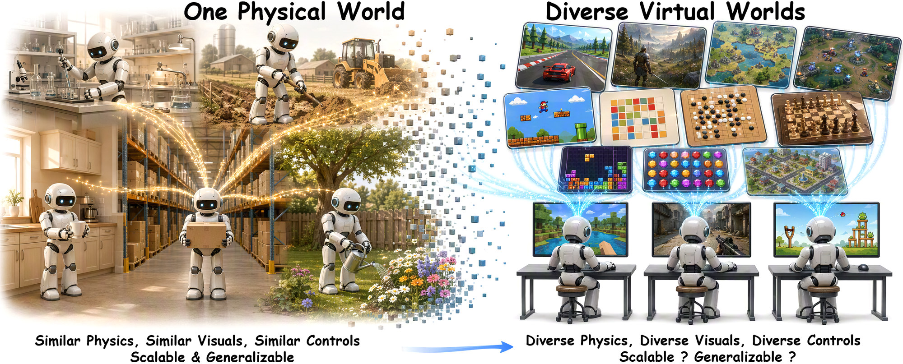
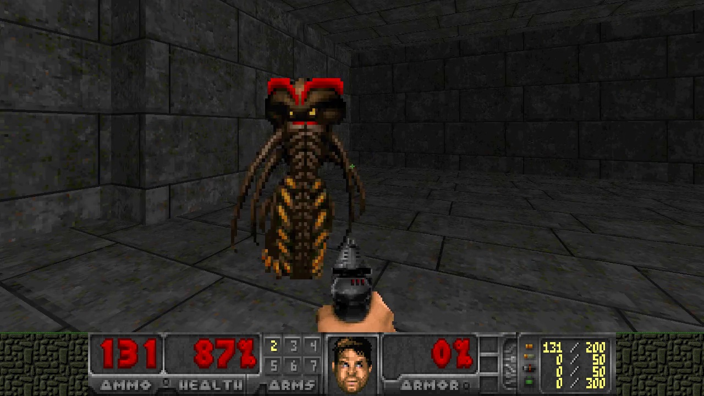

<div align="center">

<p align="center">
  
</p>

<h1 align="center" style="font-size:3.2em;line-height:1.1;margin:0.2em 0 0.15em;">Scaling in Games</h1>

<h2 align="center" style="font-size:1.5em;line-height:1.3;font-weight:600;margin:0 0 0.9em;border:none;">Continued Pre-Training for Embodied Agents in Diverse Virtual Worlds</h2>

<p align="center" style="line-height:1.5;margin:0.4em 0 0.3em;">
<span style="white-space:nowrap;"><b>Kuan Zhang</b><sup>1,2,*,‡</sup></span>, <span style="white-space:nowrap;"><b>Yukun Chen</b><sup>1,3,*,‡</sup></span>, <span style="white-space:nowrap;"><b>Zhihao Yang</b><sup>1,3,*,‡</sup></span>, <span style="white-space:nowrap;">Yue Su<sup>4</sup></span>, <span style="white-space:nowrap;">Xiangnan Wu<sup>3</sup></span>, <span style="white-space:nowrap;">Zirong Chen<sup>2</sup></span>, <span style="white-space:nowrap;">Run Luo<sup>1,5,‡</sup></span>, <span style="white-space:nowrap;">Jinkun Hou<sup>6</sup></span>, <span style="white-space:nowrap;">Tao Tan<sup>1</sup></span>, <span style="white-space:nowrap;"><b>Yinhe Zheng</b><sup>1,†</sup></span>, <span style="white-space:nowrap;"><b>Yiming Li</b><sup>2,†</sup></span>
</p>

<p align="center" style="font-size:0.85em;line-height:1.5;margin:0 0 0.6em;">
<span style="white-space:nowrap;"><sup>1</sup>miHoYo Honkai AI R&amp;D Team</span> &nbsp; <span style="white-space:nowrap;"><sup>2</sup>College AI, Tsinghua University</span> &nbsp; <span style="white-space:nowrap;"><sup>3</sup>University of Chinese Academy of Sciences</span> &nbsp; <span style="white-space:nowrap;"><sup>4</sup>MMLab, The University of Hong Kong</span> &nbsp; <span style="white-space:nowrap;"><sup>5</sup>National University of Singapore</span> &nbsp; <span style="white-space:nowrap;"><sup>6</sup>Peking University</span><br>
<span style="white-space:nowrap;"><sup>*</sup>Equal contribution</span> &nbsp; <span style="white-space:nowrap;"><sup>†</sup>Corresponding author</span> &nbsp; <span style="white-space:nowrap;"><sup>‡</sup>Work done while interning at miHoYo</span>
</p>

<p align="center">
  <a href="https://gamescaling.github.io" style="display:inline-block;margin:2px;"></a>
  <a href="https://gamescaling.github.io" style="display:inline-block;margin:2px;"></a>
  <a href="https://github.com/THUSI-Lab/GameScaling" style="display:inline-block;margin:2px;"></a>
  <a href="https://huggingface.co/THUSI-Lab/GameScaling" style="display:inline-block;margin:2px;"></a>
  <a href="https://www.apache.org/licenses/LICENSE-2.0" style="display:inline-block;margin:2px;"></a>
</p>

</div>

<p align="center">
  
</p>

## Overview

GameScaling models are Qwen3.5 vision-language models with continued pre-training on
keyboard-and-mouse gameplay. Each call takes the current game frame (plus a short history of past
frames and actions) and returns the next **200 ms of keyboard and mouse actions**: 6 steps of
33 ms each, plus one mouse movement and scroll for the whole chunk. The model may think before it
acts.

This GitHub repository holds the inference client, the standard system-prompt template, the
example and the tests. The eight checkpoints are on Hugging Face,
[THUSI-Lab/GameScaling](https://huggingface.co/THUSI-Lab/GameScaling); download them with
`hf download` (§1). There is no training code. Paper results and analysis are on the [project page](https://gamescaling.github.io).

## Checkpoints

| Model | Folder | Weights | GPUs (bf16) |
|---|---|---:|:---:|
| GameScaling-0.8B-S1 | `models/0p8b_s1_1600h_gs6736` | 2.2 GB | 1 |
| GameScaling-0.8B-S3 | `models/0p8b_s3_1600h_gs6760` | 2.2 GB | 1 |
| GameScaling-2B-S1 | `models/2b_s1_1600h_gs6736` | 5.4 GB | 1 |
| GameScaling-2B-S3 | `models/2b_s3_1600h_gs6760` | 5.4 GB | 1 |
| GameScaling-9B-S1 | `models/9b_s1_1600h_gs6736` | 18.8 GB | 1 |
| GameScaling-9B-S3 | `models/9b_s3_1600h_gs6760` | 18.8 GB | 1 |
| GameScaling-27B-S1 | `models/27b_s1_1600h_gs6995` | 54.7 GB | 2 (tensor parallel) |
| GameScaling-27B-S3 | `models/27b_s3_1600h_gs7020` | 54.7 GB | 2 (tensor parallel) |

- **S1** is trained on Minecraft gameplay only. **S3** is a balanced mixture: 27% Minecraft, the
  rest from other games. All checkpoints use 1,600 h of gameplay.
- Folder names are `<size>_<mixture>_<hours>h_gs<training steps>`. Weights are bfloat16, from the
  Qwen3.5-0.8B / 2B / 9B / 27B backbones.

## File tree

Everything except `models/` is in this repository. `models/` is on Hugging Face only and lands in
this layout when downloaded with `--local-dir .` (§1).

```text
GameScaling/
├── models/                     [Hugging Face] eight checkpoints, one folder each
│   ├── 0p8b_s1_1600h_gs6736/
│   │   ├── config.json         Qwen3.5 architecture, bfloat16
│   │   ├── model.safetensors   weights (27B: 2 shards + index)
│   │   ├── chat_template.jinja required, renders history turns
│   │   ├── tokenizer.json
│   │   ├── tokenizer_config.json
│   │   ├── generation_config.json
│   │   ├── preprocessor_config.json
│   │   ├── processor_config.json
│   │   └── video_preprocessor_config.json
│   ├── 0p8b_s3_1600h_gs6760/
│   ├── 2b_s1_1600h_gs6736/
│   ├── 2b_s3_1600h_gs6760/
│   ├── 9b_s1_1600h_gs6736/
│   ├── 9b_s3_1600h_gs6760/
│   ├── 27b_s1_1600h_gs6995/
│   └── 27b_s3_1600h_gs7020/
├── prompts/
│   ├── system_prompt_template.txt  standard prompt, 3 slots (§2)
│   └── example_doom_battle1.txt    complete Doom prompt (§2)
├── examples/
│   ├── doom_battle1.jpg        test frame (1280x720)
│   ├── doom_battle1_action.txt the model's reply on that frame
│   └── run_example.py          frame in, action out (§3)
├── gamescaling/                inference client
│   ├── prompt.py               system prompt builders
│   ├── policy.py               client and request body
│   ├── action.py               action format and parser
│   └── keymaps.py              key names <-> browser keys
├── scripts/serve_vllm.sh       start a vLLM server
├── tests/test_core.py          offline tests (no GPU)
├── assets/                     images for this README
├── requirements.txt            client deps: requests, Pillow
└── LICENSE                     Apache 2.0
```

## 1. Download and serve

Clone the code, then download only the checkpoint you need from Hugging Face into `models/`:

```bash
git clone https://github.com/THUSI-Lab/GameScaling.git
cd GameScaling
pip install -U huggingface_hub
hf download THUSI-Lab/GameScaling --include "models/9b_s1_1600h_gs6736/*" --local-dir .
```

Use any folder name from the Checkpoints table; `--include "models/*"` fetches all eight
(about 162 GB).

Serve it with vLLM (tested with 0.17.0):

```bash
pip install "vllm>=0.17"
bash scripts/serve_vllm.sh models/9b_s1_1600h_gs6736 8000        # 0.8B-9B fit on one GPU
bash scripts/serve_vllm.sh models/27b_s1_1600h_gs6995 8000 2      # 27B: tensor parallel 2
```

`serve_vllm.sh CKPT [PORT] [TP]` starts vLLM with `--served-model-name gamescaling`, bfloat16,
`--max-model-len 32768` (system prompt + 5 history frames + reasoning budget) and
`--limit-mm-per-prompt '{"image": 8}'` (5 history frames + the current one, with headroom). Set
`GPU_MEM_UTIL` to change the memory fraction (default 0.85).

Check that the server is up and the client can reach it:

```bash
curl -s http://127.0.0.1:8000/v1/models          # should list "gamescaling"
pip install -r requirements.txt
python tests/test_core.py                         # offline checks, no server needed
```

Things to keep as shipped:

- **Chat template.** Use the `chat_template.jinja` in the checkpoint folder (vLLM loads it by
  default). Do not replace it with the stock Qwen template: this one renders past turns without
  reasoning as `<think>\n\n</think>\n\n<|action_start|>...`, token-for-token as in training.
- **Special tokens.** Requests must set `skip_special_tokens: false`, or the server strips the
  `<|action_start|>` / `<|action_end|>` tags. `build_request` already does this.
- **One server per GPU group.** One vLLM replica can serve several games at once, but long
  prefills (one image per history turn) make each step slower when many games share it.

## 2. System prompt

`prompts/system_prompt_template.txt` is the standard system prompt. Fill in three placeholders
and keep everything else exactly as written: the model decides its output tags from the exact
text of the Output Format section.

| Placeholder | What to write |
|---|---|
| `{GAME_NAME}` | The game's name. It appears twice: in the opening and in the key-list heading. |
| `{GAME_RULES}` | What the game is, what is on screen, the goal and how it is scored. Plain text; several lines are fine. |
| `{KEY_BINDINGS}` | One `- <key> -> <effect>` line per key, in training key names (§5). End with the mouse line below if the mouse turns the camera. |

The mouse line, copied verbatim:

```text
- Mouse X Y -> aim / rotate the camera (X>0 right, Y>0 down)
```

**Note.** Lines such as `**Game Rules**`, `**Output Format**` and
`**Explanation**` are plain-text section headers that the model saw in training. They are part
of the prompt, not Markdown formatting: send them to the model unchanged, including the
asterisks.

### Complete example: Doom Battle-1

This is the full system prompt for the ViZDoom Battle-1 map, as in
`prompts/example_doom_battle1.txt`. It is the same text in both reasoning modes (§4). Long
lines scroll horizontally; each line break below is a real `\n` in the prompt.

```text
You are a gaming expert, and you are currently playing Doom Battle-1. You are proficient in keyboard and mouse operations. You understand game mechanics and combat pacing, can quickly extract key information from the current screen, and can think and make precise decisions at critical moments. Based on the current screen, plan the next 200ms of actions, consisting of 6 steps spaced 33ms apart. Each step lasts 33ms, until the next step begins. If the current situation continues the previous strategy, output the action directly. Think only when the situation changes significantly, the previous analysis is no longer valid, or a new objective appears.
**Game Rules**
You are playing Doom, a first-person shooter, in an arena full of monsters. Survive and kill as many monsters as you can.

## What you see on screen
- First-person view.
- The crosshair at screen centre marks where shots land.
- The status bar along the bottom shows HEALTH on the left and AMMO on the right.
- Monsters keep arriving for the whole episode; some throw fireballs from range.

## Rules
- Score is the number of monsters you kill in the episode.
- Firing costs ammo, and the episode ends as soon as your health reaches 0, so dodging matters as much as shooting: standing still in the open is how most episodes end early.
- Health packs and ammo boxes lie around the map; walk over one to pick it up. Running out of either is fatal, so collect them while fighting.
- A target is hit when it is under the crosshair, so turn with the mouse until the monster is centred before firing.
- The map is one large open arena, so monsters can close in from any direction.
**Common Keys in Doom Battle-1**
- W -> Move forward
- A -> Strafe left
- S -> Move backward
- D -> Strafe right
- LB -> Fire weapon
- Ctrl -> Fire weapon (keyboard alternative)
- Shift -> Run
- Space -> Open doors / use switches
- one -> Select weapon slot 1
- two -> Select weapon slot 2
- three -> Select weapon slot 3
- Mouse X Y -> aim / rotate the camera (X>0 right, Y>0 down)
**Output Format**
**Action only (usual)**
<think></think><|action_start|>X Y Z ; k1 k2 k3 ; k4 k5 ; k6 ; k7 ; k8 ; k9 k10<|action_end|>
**Thinking + action (when necessary)**
<think>reasoning</think><|action_start|>X Y Z ; k1 k2 k3 ; k4 k5 ; k6 ; k7 ; k8 ; k9 k10<|action_end|>
**Explanation**
1. **Mouse Movement**: First, specify the relative displacement X, Y (X>0 means move right, Y>0 means move down) and scroll amount Z (Z>0 means scroll up).
2. **Key Sequence**: Then list 6 groups of keys; within each group, keys are separated by spaces, and groups are separated by semicolons.
- Each group can contain up to 4 keys.
- If a group has no keys, leave it empty but keep the `;`.
3. Only output a plain string that conforms to the above format — no line breaks and no quotation marks.
**Key Naming Rules**
- Number keys `0-9`: use lowercase English words, e.g., `zero` for `0`, `one` for `1`, ... `nine` for `9`.
- Function keys `F1-F12`: use capitalized English words, e.g., `One` represents `F1`, `Two` represents `F2`, and so on.
- Mouse buttons: use `LB`, `RB`, `MB` for the left, right, and middle mouse button.
- Letters: use the uppercase letter, e.g., `A`, `D`, `W`, `S`.
- Arrow keys: use `Up`, `Down`, `Left`, `Right`.
- Modifier/special keys: `Shift`, `Ctrl`, `Alt`, `Tab`, `Caps`, `Esc`, `Space`, `Enter`, `Back` (backspace), `Delete`, `Insert`, `Home`, `End`, `Pause`.
```

The same prompt from code (`tests/test_core.py` checks that it matches the file byte for byte):

```python
from gamescaling import build_system_prompt

DOOM_RULES = open("prompts/example_doom_battle1.txt").read() \
    .split("**Game Rules**\n", 1)[1].split("\n**Common Keys in", 1)[0]

system = build_system_prompt(
    "Doom Battle-1",
    rules=DOOM_RULES,
    key_bindings=[
        ("W", "Move forward"), ("A", "Strafe left"), ("S", "Move backward"), ("D", "Strafe right"),
        ("LB", "Fire weapon"), ("Ctrl", "Fire weapon (keyboard alternative)"), ("Shift", "Run"),
        ("Space", "Open doors / use switches"), ("one", "Select weapon slot 1"),
        ("two", "Select weapon slot 2"), ("three", "Select weapon slot 3"),
    ],
    mouse_aim=True,   # appends the "Mouse X Y -> ..." line
)
```

Filling the text file directly gives the same result:

```python
tpl = open("prompts/system_prompt_template.txt").read().rstrip("\n")
system = (tpl.replace("{GAME_NAME}", "Doom Battle-1")
             .replace("{GAME_RULES}", DOOM_RULES)
             .replace("{KEY_BINDINGS}", "- W -> Move forward\n- A -> Strafe left\n..."
                      "\n- Mouse X Y -> aim / rotate the camera (X>0 right, Y>0 down)"))
```

## 3. Minimal usage

```python
from PIL import Image
from gamescaling import GameScalingPolicy, PolicyConfig

policy = GameScalingPolicy(system, PolicyConfig())   # system prompt from §2; prefills <think>
policy.reset()                                       # call at the start of every episode
decision = policy.act(Image.open("frame.png"))       # one call = one 200 ms decision
a = decision.action
a.mouse      # (X, Y, Z): mouse movement for this chunk (per-mille of the screen) + scroll
a.steps      # 6 groups: the keys held during each 33 ms step
a.parsed     # False = could not be parsed; execute as a no-op
decision.reasoning   # the model's thinking for this step ("" if it acted directly)
```

Pass `a` to your executor. Run 6 steps of 33 ms, holding that step's keys during each one. Keys
that appear in two consecutive groups stay held rather than being pressed again. Mouse movement
is `X/1000 * screen width` and `Y/1000 * screen height`. You can spread it over the 200 ms or
send it at once. The frame is sent at its native size; set `PolicyConfig(image_size=(w, h))` to
resize it first.

### Test frame

`examples/doom_battle1.jpg` is a frame from a Doom Battle-1 episode played by GameScaling-9B-S3.
A monster stands just left of the crosshair.

<p align="center">
  
</p>

The model's reply on this frame (`examples/doom_battle1_action.txt`), with the system prompt from
§2:

```text
<think>

</think>

<|action_start|>-37 -3 0 ; LB S ; LB ; LB ; LB ; LB ; LB<|action_end|>
```

It acts without thinking, turns left by 37/1000 of the screen width, and holds fire for the
whole 200 ms (with a short step back in the first 33 ms). The shot killed the monster.

Run the same frame against your server:

```bash
python examples/run_example.py --offline       # no server
python examples/run_example.py                 # prefill <think>
python examples/run_example.py --no-reasoning  # no thinking
```

Each reply should parse into a valid action chunk (`parsed=True`); the script exits non-zero
otherwise. Sampling is at temperature 1.0 and the reference reply had five earlier frames in
context, so live replies differ in detail.

## 4. Reasoning modes and message structure

The assistant turn is always prefilled, and the request continues it
(`continue_final_message=True`). The system prompt is the same in both modes.

| Mode | Prefill | What the model does |
|---|---|---|
| `PolicyConfig()` (default, `reasoning=True`) | `<think>` | Decides whether and how long to think, closes `</think>`, then outputs the action |
| `PolicyConfig(reasoning=False)` | `<think>\n\n</think>` | Thinking is closed and empty; the model outputs the action chunk directly |

`<think>\n\n</think>` is exactly how the chat template renders a turn without reasoning, so the
no-reasoning mode stays in the training format. Do not send the request without a prefill.

Each user turn is the text `current game screen` followed by the frame. Multi-turn messages
(`policy.py`):

```text
system     system prompt (§2)
user       "current game screen" + frame t-k
assistant  action taken at t-k (no reasoning)
...        (last history_len turns, default 5)
user       "current game screen" + current frame
assistant  "<think>"  or  "<think>\n\n</think>"
```

Past turns keep only the action (`history_think=0`). A turn that failed to parse is stored as an
explicit no-op, `<|action_start|>0 0 0 ; ; ; ; ; ; <|action_end|>`, not as the raw bad output.

Client defaults: `temperature=1.0`, `max_tokens=2048`, `stop=["<|action_end|>"]`,
`skip_special_tokens=false`, JPEG frames (quality 90) at native resolution.

## 5. Action format

```text
<|action_start|>X Y Z ; g1 ; g2 ; g3 ; g4 ; g5 ; g6<|action_end|>
```

- `X Y`: mouse movement over the whole 200 ms, in per-mille of the screen
  (`X = Σdx / screen width × 1000`), clipped to ±1000. X>0 is right, Y>0 is down.
- `Z`: scroll notches, clipped to ±5. Z>0 is up.
- `g1..g6`: six 33 ms steps. Each group lists the keys held during that step, at most 4. An
  empty group releases all keys, but the `;` must stay.
- `<|action_start|>` / `<|action_end|>` are special tokens. Requests must set
  `skip_special_tokens: false` (`build_request` does), or the server strips the tags.
  `parse_action` also accepts a bare `X Y Z ; ...` as a fallback.
- The action is read only after the last `</think>`: a model that thinks often quotes the format
  inside its reasoning. An unclosed `<think>` means the generation was cut off; it is executed as
  a no-op (`Action.truncated=True`).

Training key vocabulary (74 tokens, case-sensitive, `gamescaling.action.KEY_VOCAB`):

| Group | Tokens |
|---|---|
| Letters | `A`..`Z` |
| Number row | `zero` `one` .. `nine` |
| F1-F12 | `One` `Two` .. `Twelve` (capitalized = function key) |
| Mouse buttons | `LB` `RB` `MB` |
| Arrows | `Up` `Down` `Left` `Right` |
| Other | `Shift` `Ctrl` `Alt` `Tab` `Caps` `Esc` `Space` `Enter` `Back` `Delete` `Insert` `Home` `End` `Pause` `Equal` `Minus` `Period` `Slash` `Quote` |

Tokens outside the vocabulary are dropped and recorded in `Action.dropped`.
`keymaps.TO_PLAYWRIGHT` and `keymaps.TO_UE5` map them to browser and Unreal Engine key names;
`translate_controls` rewrites browser key names in a text into training tokens.

## 6. Running it in a game

1. Write the system prompt for your game (§2).
2. Capture the current frame and call `policy.act(frame)` once per decision.
3. Execute the returned `Action` as in §5: held keys for 6 steps of 33 ms, plus mouse movement
   and scroll.
4. Call `policy.reset()` when an episode ends.

Before trusting the results, check:

- **Parse rate.** `Decision.action.parsed` should almost always be `True`. Many failures, or many
  `Action.truncated`, usually mean a replaced chat template, stripped special tokens, a missing
  prefill, or a too-small `max_tokens`.
- **Actions take effect.** Each chunk runs in wall-clock time (6 × 33 ms). If the game renders
  slowly, for example several game instances sharing one GPU, held keys barely move the
  character and nothing reports an error. Watch a recording before reading any numbers.
- **Several episodes.** Single episodes vary a lot at `temperature=1.0`.

## 7. Tests

```bash
python tests/test_core.py      # or: python -m pytest tests/
```

Offline checks of prompts, request bodies and action parsing; no GPU or server needed.

## License

GameScaling is a **purely scientific research** project. We carry out **no commercial activity** of
any kind with it: nothing here is sold, licensed for a fee, or used in any product or service.

- **Models and code: Apache-2.0.** The weights and the inference code are released under the
  [Apache License 2.0](LICENSE). The models are continued pre-trained from
  [Qwen3.5](https://huggingface.co/Qwen/Qwen3.5-9B), which is also Apache 2.0.
- **Gameplay data is not released.** The training corpus stays private; game frames in this
  repository (e.g. `examples/doom_battle1.jpg`) only illustrate how to use the model.
- **Game copyright belongs to the publishers.** All game titles, footage, copyrights, trademarks and
  other game assets referenced here belong to their respective publishers and owners. The Apache
  2.0 licence covers our weights and code only and grants no right to any game content.

## Citation

```bibtex
@article{zhang2026scaling,
  title   = {Scaling in Games: Continued Pre-Training for Embodied Agents in Diverse Virtual Worlds},
  author  = {Zhang, Kuan and Chen, Yukun and Yang, Zhihao and Su, Yue and Wu, Xiangnan and
             Chen, Zirong and Luo, Run and Hou, Jinkun and Tan, Tao and Zheng, Yinhe and Li, Yiming},
  journal = {arXiv preprint},
  year    = {2026}
}
```
